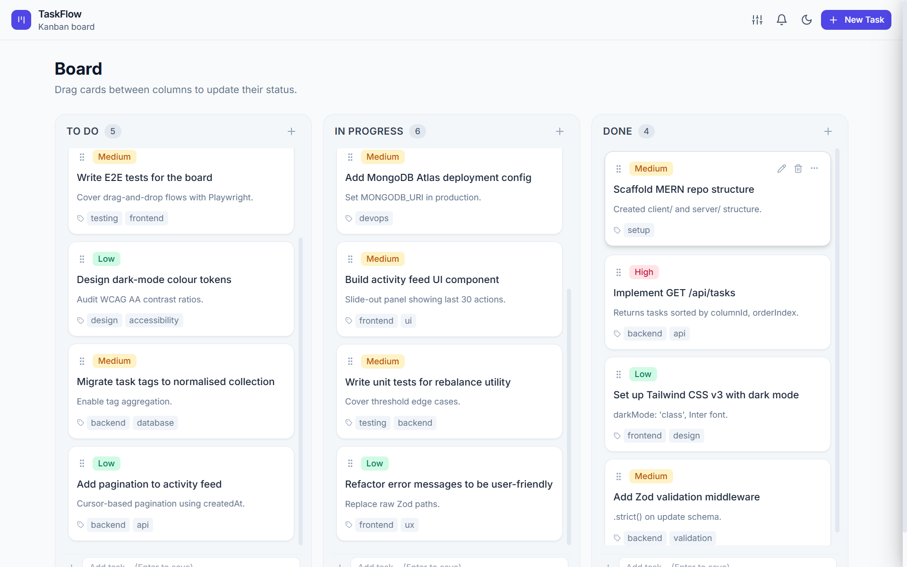
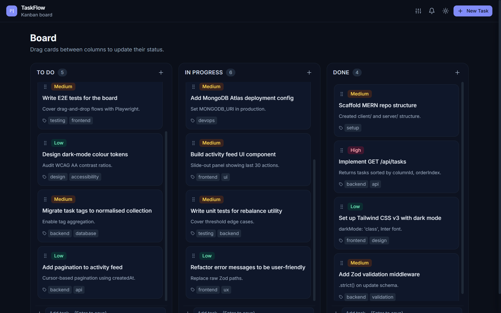

# TaskFlow

A resilient, MERN-stack Kanban board with optimistic drag-and-drop, concurrency guards, an audit/activity log, and a built-in chaos-testing panel.

🔗 **Live Demo**: [https://task-flow-lake-one.vercel.app](https://task-flow-lake-one.vercel.app/)  
⚡ **Backend API**: [https://taskflow-1yvj.onrender.com/api](https://taskflow-1yvj.onrender.com/api)

### Light Mode


### Dark Mode


---

## Features

| Area | Detail |
|------|--------|
| **Board** | Three fixed columns: To Do · In Progress · Done |
| **Cards** | Title, description, priority badge (Low/Medium/High), tag chips |
| **Drag & Drop** | `@dnd-kit` with keyboard support; drop anywhere in a column |
| **Optimistic moves** | Cards reorder instantly; network failure rolls the card back with a shake animation |
| **Concurrency guard** | Per-task promise queue — rapid moves of the same card never produce a `409 STALE_VERSION` race condition |
| **Activity log** | Slide-over drawer showing every create / update / move / delete with day grouping and cursor pagination |
| **Chaos panel** | DevTools popover to simulate network failures and latency (great for live demos) |
| **Dark mode** | `prefers-color-scheme` aware; manually toggleable; WCAG AA contrast in both themes |
| **Responsive** | Desktop: 3-column grid. Mobile ≤ 768 px: horizontal scroll-snap, ~85vw columns |
| **Accessible** | Visible focus rings, aria-labels on all icon buttons, ARIA live region for moves, modal focus traps |

---

## Tech Stack

| Layer | Technologies |
|-------|-------------|
| **Client** | Vite · React (JavaScript) · Tailwind CSS v3.4 · Zustand · @dnd-kit · lucide-react · react-hot-toast |
| **Server** | Node 20 · Express · Mongoose · Zod · Morgan · dotenv · nodemon |
| **Database** | MongoDB (Atlas or local) |

---

## Folder Structure

```
taskflow/
├── client/
│   ├── src/
│   │   ├── api/          # fetch wrapper + ApiError
│   │   ├── components/   # Board, Column, Card, Modals, Drawer, Navbar
│   │   │   └── ui/       # Button, IconButton, Modal, Badge, Skeleton…
│   │   ├── hooks/        # useColumns, useActivity, useTheme
│   │   ├── store/        # useBoardStore (Zustand)
│   │   └── utils/        # constants, order-index helpers
│   ├── .env              # local env (git-ignored)
│   └── .env.example      # copy → .env
│
├── server/
│   ├── src/
│   │   ├── config/       # db.js (Mongoose connect + lifecycle events)
│   │   ├── controllers/  # taskController, activityController
│   │   ├── middleware/   # errorHandler, notFound, validate
│   │   ├── models/       # Task, Activity
│   │   ├── routes/       # taskRoutes, activityRoutes
│   │   ├── seed/         # seed.js
│   │   ├── services/     # activityService (logActivity)
│   │   ├── shared/       # constants (COLUMNS, COLUMN_LABELS, …)
│   │   └── utils/        # asyncHandler, rebalance
│   ├── .env              # local env (git-ignored)
│   └── .env.example      # copy → .env
│
├── README.md
├── DECISIONS.md
└── .gitignore
```

---

## Prerequisites

- **Node.js** ≥ 20
- **MongoDB** running locally on port 27017 **or** a MongoDB Atlas connection string
- **npm** (comes with Node)

---

## Environment Setup

### Server — `server/.env`

```bash
cp server/.env.example server/.env
```

```env
PORT=8000
MONGODB_URI=mongodb://localhost:27017/taskflow
CLIENT_ORIGIN=http://localhost:5173
NODE_ENV=development
```

> For **Atlas**: replace `MONGODB_URI` with your Atlas connection string, e.g.  
> `MONGODB_URI=mongodb+srv://<user>:<password>@cluster0.xxxxx.mongodb.net/taskflow`

### Client — `client/.env`

```bash
cp client/.env.example client/.env
```

```env
VITE_API_URL=http://localhost:8000/api
```

---

## Running the App

Open **two terminals**:

### Terminal 1 — Server

```bash
cd server
npm install
npm run dev
```

Server starts on **http://localhost:8000**. You should see:

```
✅  MongoDB connected: 127.0.0.1
🚀  Server running on http://localhost:8000
```

### Terminal 2 — Client

```bash
cd client
npm install
npm run dev
```

App opens at **http://localhost:5173**.

---

## Seeding Sample Data

Populates 15 tasks and 8 curated activity entries with realistic timestamps:

```bash
cd server
npm run seed
```

> This **deletes all existing tasks and activities** before inserting the seed data. Run it on an empty or dev database only.

---

## API Reference

All errors are `{ error: string, code?: string }`.

| Method | Endpoint | Description | Success |
|--------|----------|-------------|---------|
| `GET` | `/api/health` | Health check | `200 { status: "ok" }` |
| `GET` | `/api/tasks` | All tasks, sorted by column + orderIndex | `200 { tasks }` |
| `POST` | `/api/tasks` | Create task | `201 { task }` |
| `PATCH` | `/api/tasks/:id` | Edit title/description/priority/tags | `200 { task }` |
| `DELETE` | `/api/tasks/:id` | Delete task | `204` |
| `PATCH` | `/api/tasks/:id/move` | Move/reorder; body `{ columnId, orderIndex, version }` | `200 { task }` · `409 { code: "STALE_VERSION" }` |
| `GET` | `/api/activity` | Activity feed; `?limit=30&before=<ISO>` | `200 { activities, nextCursor }` |

### orderIndex Scheme

- New card at bottom: `lastCard.orderIndex + 1000`
- Between two cards: midpoint of their `orderIndex` values
- Top of column: `firstCard.orderIndex - 1000`
- Empty column: `1000`
- Gap collapses below `0.001` → server rebalances the whole column

---

## Testing the Chaos Panel (Failure Simulator)

The **Dev Tools** button (sliders icon ⚙) in the top-right of the navbar opens a panel that lets you simulate degraded network conditions **without changing any server code**.

### Simulate a 500 failure (rollback demo)

1. Click the sliders icon → toggle **"Simulate failure (500)"** ON.
2. Drag any card to a different column, or use the ⋯ kebab menu → "Move to …".
3. **What you see:**
   - The card hops to its new position immediately (optimistic update).
   - The simulated 500 fires; the store catches it.
   - The card shakes and snaps back to its original position (rollback to `lastConfirmed`).
   - A red toast appears: *"Couldn't move '…'. Reverted."*
4. Toggle the failure switch OFF — moves work normally again.

### Simulate latency (queue demo)

1. Set **Latency** to `1500 ms` or `3000 ms`.
2. Move the same card 3–4 times rapidly.
3. **What you see:**
   - Every move applies to the UI instantly.
   - Cards pulse with a subtle opacity animation while pending.
   - Moves confirm one-by-one in order without any `409 STALE_VERSION` errors.
   - Moving a *different* card runs in parallel with no interference.

> The amber dot on the sliders icon is always visible while any simulation is active — so you don't forget you're in chaos mode.

---

## Key Architecture Decisions

See [`DECISIONS.md`](./DECISIONS.md) for a full breakdown. Highlights:

- **`orderIndex` as float with 1000-gap**: Avoids shifting all sibling cards on every move; the server rebalances only when the gap shrinks below `0.001`.
- **Per-task promise queue**: `Map<taskId, Promise>` serialises moves of the same card so rapid drags never produce stale-version conflicts.
- **`lastConfirmed` rollback anchor**: Each task stores the last server-confirmed `{ columnId, orderIndex, version }`. On failure, the UI snaps back to this snapshot.
- **Epoch counter**: Incremented on rollback so still-queued continuations of a failed move skip execution rather than firing stale operations.
- **`tasksById` map**: Tasks stored as `Record<id, Task>` in Zustand — structurally prevents duplicate cards because writing the same id overwrites the slot rather than pushing to an array.

